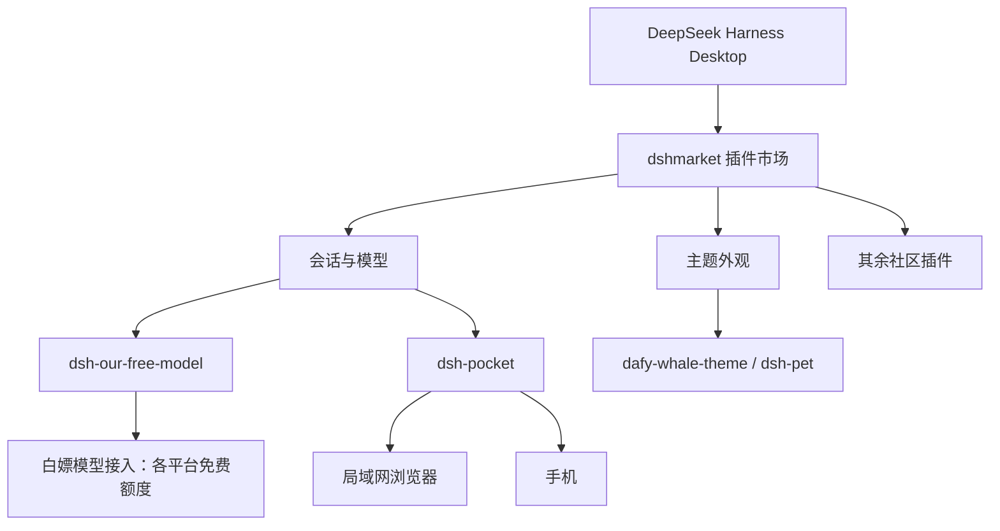

# 整体结构



# 安装 Desktop 客户端

从官方渠道下载并安装 Desktop 客户端，登录后先确认能正常新建会话。Harness 的命令行工具会随客户端一起提供，插件和主题既可以用命令行装，也可以装好插件市场后在界面里点。

> [!TIP]
> 下面的子命令以我本地版本为准。如果你的版本不一样，直接 `dsh --help` 看一下最快。

安装完毕后，第一件要做的事，添加dsh命令到环境变量：


## 对于Desktop客户端，记住使用dsh命令时，带上 `--profile desktop`

Harness 用 profile 区分不同的运行环境。Desktop 客户端和纯命令行各自是一套 profile，插件只会装在其中一个里面，另一个是看不到的。命令行默认profile是web，因为官方一开始并没有做客户端。

所以安装插件的命令模板是：

```bash
dsh plugin --profile desktop add <插件名>
```

> [!WARNING] 最容易踩的坑
> 如果你照着 CLI 的教程直接执行 `dsh plugin install xxx`，插件会装到默认 profile 里，Desktop 客户端那边大概率找不到。装完发现「没生效」，先检查是不是漏了 `--profile desktop`。

# 第一件事：装插件市场 dshmarket

装好客户端、确认能新建会话后，**先别急着一个个敲命令**。第一步应该是装 [dshmarket](https://github.com/dsh-market/dsh-market)（官网 [dshmarket.com](https://dshmarket.com)）：它把插件市场做进了 DSH 里，之后找插件、看说明和截图、一键安装/更新/停用，都在界面里完成。

Desktop 客户端里最省事的方式是直接在应用内装：


用命令行的话，还是同一个模板：

```bash
dsh plugin --profile desktop add dshmarket
```

装完后记得打开侧边栏：


> [!WARNING] 两个坑
>
> - 官方 README 专门写了：在装了 Desktop 的机器上执行 `dsh plugin --profile web add dshmarket`，命令会提示成功，但插件装进了 `profiles/web`，Desktop 里看不到。所以要么用应用内的 **Settings → Plugins**，要么确认 profile 名（我这里是 `desktop`）。
> - 市场要求 dsh web **0.1.0-rc.6** 及以上。如果 Desktop 自带的 dsh 比较老，「插件市场」入口不会出现，控制台里还会留一行提示——先去升级客户端。

有了市场，后面这些插件直接搜名字点安装就行，不用再记包名。下面我仍然保留命令行写法，方便一次装一批，或者市场打不开的时候备用。

> [!NOTE] 市场不等于安全审计
> 它只保证插件来源在收录列表里。插件是第三方代码，跑在你 agent 的权限下，装之前扫一眼仓库和它申请的权限。

# 我的插件清单

| 插件                            | 用途                                                  |
| ------------------------------- | ----------------------------------------------------- |
| `dshmarket`                     | 插件市场：在 DSH 里浏览、搜索、一键安装社区插件和主题 |
| `dsh-pocket`                    | 通过局域网在手机等设备访问会话                        |
| `DViridescent/dafy-whale-theme` | 大肥鱼主题插件                                        |
| `PC2005-cloud/dsh-pet`          | 大肥鱼桌宠                                            |

## dsh-pocket：局域网/手机也能访问

`dsh-pocket` 解决的是「人离开电脑，但会话还想继续」的问题。它会把当前会话通过局域网暴露出来，因为dsh做了安全措施，禁止了`0.0.0.0`的访问，这个插件可以解决这个问题。


安装：

使用插件市场搜索，或者：

```bash
dsh plugin --profile desktop add dsh-pocket
```

如图所示，手机访问，扫码即可打开网页，在手机上的网页访问。

或是跟电脑一样，用：`http://<ip>:3081`，即图中显示的IP和端口访问即可。

为了安全起见，插件做了功能，需要输入安全密码登录，输入即可。

# 主题插件：大肥鱼

功能配完，剩下就是外观。如果你也喜欢大肥鱼，可以看看这两个：

- [DViridescent/dafy-whale-theme](https://github.com/DViridescent/dafy-whale-theme) 大肥鱼页面主题
- [PC2005-cloud/dsh-pet](https://github.com/PC2005-cloud/dsh-pet) 大肥鱼桌宠

安装：

使用插件市场搜索，或者：

```bash
dsh plugin --profile desktop add github:DViridescent/dafy-whale-theme
dsh plugin --profile desktop add github:PC2005-cloud/dsh-pet
```

下图中，背景为dafy-whale-theme，桌宠为`dsh-pet`


命令行装完如果没立刻变化，刷新页面或重启客户端。
