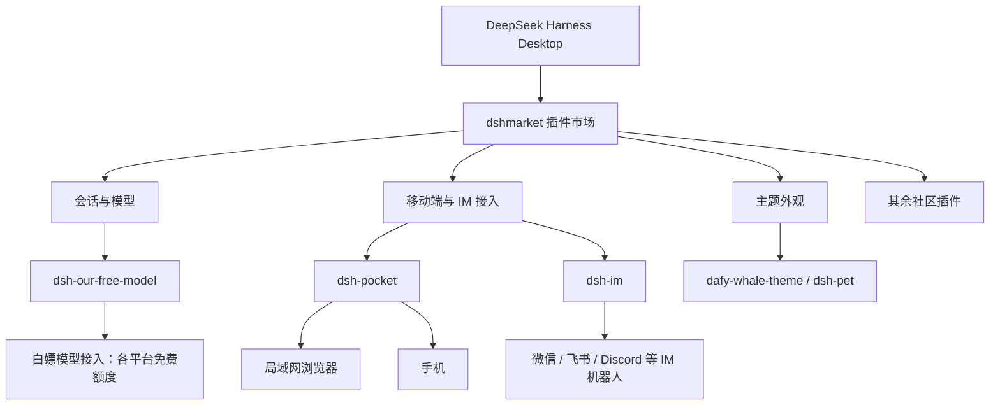

# 整体结构



# 安装 Desktop 客户端

从官方渠道下载并安装 Desktop 客户端，登录后先确认能正常新建会话。Harness 的命令行工具会随客户端一起提供，插件和主题既可以用命令行装，也可以装好插件市场后在界面里点。

> [!TIP]
> 下面的子命令以我本地版本为准。如果你的版本不一样，直接 `dsh --help` 看一下最快。

安装完毕后，第一件要做的事，添加dsh命令到环境变量：


## 对于Desktop客户端，记住使用dsh命令时，带上 `--profile desktop`

Harness 用 profile 区分不同的运行环境。Desktop 客户端和纯命令行各自是一套 profile，插件只会装在其中一个里面，另一个是看不到的。命令行默认profile是web，因为官方一开始并没有做客户端。

所以安装插件的命令模板是：

```bash
dsh plugin --profile desktop add <插件名>
```

> [!WARNING] 最容易踩的坑
> 如果你照着 CLI 的教程直接执行 `dsh plugin install xxx`，插件会装到默认 profile 里，Desktop 客户端那边大概率找不到。装完发现「没生效」，先检查是不是漏了 `--profile desktop`。

# 第一件事：装插件市场 dshmarket

装好客户端、确认能新建会话后，**先别急着一个个敲命令**。第一步应该是装 [dshmarket](https://github.com/dsh-market/dsh-market)（官网 [dshmarket.com](https://dshmarket.com)）：它把插件市场做进了 DSH 里，之后找插件、看说明和截图、一键安装/更新/停用，都在界面里完成。

Desktop 客户端里最省事的方式是直接在应用内装：


用命令行的话，还是同一个模板：

```bash
dsh plugin --profile desktop add dshmarket
```

装完后记得打开侧边栏：


> [!WARNING] 两个坑
>
> - 官方 README 专门写了：在装了 Desktop 的机器上执行 `dsh plugin --profile web add dshmarket`，命令会提示成功，但插件装进了 `profiles/web`，Desktop 里看不到。所以要么用应用内的 **Settings → Plugins**，要么确认 profile 名（我这里是 `desktop`）。
> - 市场要求 dsh web **0.1.0-rc.6** 及以上。如果 Desktop 自带的 dsh 比较老，「插件市场」入口不会出现，控制台里还会留一行提示——先去升级客户端。

有了市场，后面这些插件直接搜名字点安装就行，不用再记包名。下面我仍然保留命令行写法，方便一次装一批，或者市场打不开的时候备用。

> [!NOTE] 市场不等于安全审计
> 它只保证插件来源在收录列表里。插件是第三方代码，跑在你 agent 的权限下，装之前扫一眼仓库和它申请的权限。

# 我的插件清单

| 插件                            | 用途                                                  |
| ------------------------------- | ----------------------------------------------------- |
| `dshmarket`                     | 插件市场：在 DSH 里浏览、搜索、一键安装社区插件和主题 |
| `dsh-pocket`                    | 通过局域网在手机等设备访问会话                        |
| `@xmanrui/dsh-im`               | 把微信、飞书、Discord 等 IM 机器人接入 DSH           |
| `DViridescent/dafy-whale-theme` | 大肥鱼主题插件                                        |
| `PC2005-cloud/dsh-pet`          | 大肥鱼桌宠                                            |

## dsh-pocket：局域网/手机也能访问

`dsh-pocket` 解决的是「人离开电脑，但会话还想继续」的问题。它会把当前会话通过局域网暴露出来，因为dsh做了安全措施，禁止了`0.0.0.0`的访问，这个插件可以解决这个问题。


安装：

使用插件市场搜索，或者：

```bash
dsh plugin --profile desktop add dsh-pocket
```

如图所示，手机访问，扫码即可打开网页，在手机上的网页访问。

或是跟电脑一样，用：`http://<ip>:3081`，即图中显示的IP和端口访问即可。

为了安全起见，插件做了功能，需要输入安全密码登录，输入即可。

# IM 接入插件：dsh-im

`dsh-im` 解决的是「不想开电脑，但还想继续用 agent」的问题。它把 DSH 接成 IM 机器人：微信、飞书、钉钉、企业微信、QQ、Slack、Discord等都能接，多数渠道扫个码就完事。接好之后在聊天窗口里发消息就能开新会话、切模型、看进度、远程审批，和在电脑上操作的是同一个 Harness。

安装命令和别的插件不太一样，**包名和这个 `-w` 都别手打**，直接抄：

```bash
# Desktop：在内置终端执行
dsh plugin --profile desktop add -w @xmanrui/dsh-im

# Web：在启动当前 Harness 的终端执行
dsh plugin --profile web add -w @xmanrui/dsh-im
```

装完重启 Desktop（Web 端则是重启 `dsh web` 并刷新浏览器），然后打开 **设置 → IM机器人**。入口在一级设置菜单里，排在「Agent 预设」后面；以后就从这里进，不再有单独的插件页。

> [!WARNING] 三个坑
>
> - 认准完整包名 `@xmanrui/dsh-im`。市场里名字相近的插件不少，作者在 README 里专门提醒过。
> - 命令里的 `-w` 别漏。官方给的安装命令就带着它，而前面几个插件都不带，照抄模板很容易忘。
> - 同一台机器上 Desktop 和 Web 是两套 profile，装错那个在客户端里看不到，还是要检查 `--profile desktop`。

## 能接哪些渠道

| 渠道                 | 接入方式                                     | 特点                                                                        |
| -------------------- | -------------------------------------------- | --------------------------------------------------------------------------- |
| 微信                 | 微信扫码绑定                                 | 长轮询收发；等待回答时显示「正在输入」，长回复按 1,800 字符分段             |
| 飞书                 | 扫码建机器人，或 App ID + App Secret         | 长连接；可选飞书原生的「实时直播」过程展示；每个机器人可单独开语音交互      |
| 钉钉                 | 扫码，或 Client ID + Client Secret           | Stream 长连接；用 AI Card 流式显示回答                                      |
| 企业微信             | 扫码建智能机器人，或 Bot ID + Secret         | 原生显示「正在思考中」、工具执行进度和流式回答                              |
| 企业微信自建应用     | 后台建应用，填企业 ID / AgentId / Secret 等  | HTTP 回调；私聊支持流式，支持图片输入和结果文件回传                         |
| QQ                   | 手机 QQ 扫码，或 AppID + AppSecret           | 私聊单条 Markdown 回复，群聊被 @ 后只发最终答案                             |
| Slack                | 预置 App Manifest 建应用，填两个 Token       | Socket Mode；频道被 @ 后响应，优先走官方流式消息 API                        |
| Telegram             | @BotFather 生成 Bot Token                    | 长轮询；可给每个机器人单独开私聊白名单                                      |
| Discord              | Developer Portal 生成 Bot Token              | 频道首次 @ 后自动建 Thread，之后在线程里不用重复 @                          |
| WhatsApp             | 手机 WhatsApp 扫码关联设备                   | 默认只响应账号自聊，也可切到指定联系人或开放模式                            |
| iMessage             | macOS `Messages.app` 登录并按说明授权        | 走本机原生 Messages，不需要 BlueBubbles；首版仅文本私聊                     |
| Matrix（实验）       | homeserver 地址 + 访问令牌，或用户 ID + 密码 | 支持线程、富文本和编辑式流式；加密部分仅供非敏感测试                        |

几个共通的默认行为，值得先知道：

- **每个渠道可以接多个机器人**，各自独立保存凭据、连接状态、工作区、模型、Agent Preset 和会话绑定；卡片上的操作互不影响。
- **工作区默认是 `$DSH_HOME/im`**（没设就是 `~/.dsh/im`），新会话落在「未分组」，之后可以在机器人卡片里换目录。
- **群聊天记录默认开启**：WhatsApp、飞书、Telegram、Discord、Slack、QQ 会保存实际收到的群消息和附件，按群共享、默认保留 14 天，保存本身不会触发回复；@ 一下机器人才会让它去查记录、总结或读文件。
- **图片输入**：支持图片的渠道可以发 JPEG / PNG / WebP，默认每张最多 30 MB、每条最多 20 张，超限或模型不支持时按文件处理。
- **凭据只留在本机**：Secret 和 Token 只提交给本机 Host 并写进受保护的凭据库，机器人列表和状态接口都不会回传。

## 聊天里能做什么

不用记太多，常用的是这几个：

| 命令                                       | 作用                                                     |
| ------------------------------------------ | -------------------------------------------------------- |
| `/new`                                     | 解绑当前聊天，下一条普通消息开全新会话                   |
| `/status`、`/version`                      | 看连接状态、插件版本                                     |
| `/model`、`/model <序号>`                  | 查看 / 切换当前会话模型                                  |
| `/workspace`、`/session`、`/sessionlist`   | 切工作区、绑定已有会话、列会话                           |
| `/stop`、`/steer <补充指令>`               | 停止当前任务 / 把补充指令插进正在跑的任务                |
| `/compact`、`/clear`                       | 压缩较早上下文 / 清空上下文但保留绑定                    |
| `/menu`                                    | 飞书、钉钉、企业微信、QQ 打开交互菜单，不想敲命令就用它  |

除了命令，还有两个在手机上特别好用的能力：

- **远程审批**：agent 要执行敏感操作时，直接在聊天里回 `批准` / `拒绝` 就行，和 Web 端是同一个审批，先提交的生效。
- **交互式提问**：回选项序号、选项文字或自己写，多选用逗号分隔。

## 环境要求

最新版跟着最新版 DSH 走，README 里写的支持基线是 DSH `0.2.1-rc.2`（Session 格式 v4）。所以装之前先把客户端升到较新的版本，老宿主得用对应的历史插件版本。

另外如果本机要走代理访问飞书或 Telegram，README 里有单独的环境变量写法：飞书用 `HTTPS_PROXY`，Telegram 还需要 Node.js 22.21+ 和 `NODE_USE_ENV_PROXY=1`；改完都要重启 Host。

> [!NOTE] 装完没生效怎么查
> 设置页里每个渠道都能展开「诊断详情」，点「复制诊断信息」会给出失败阶段、底层原因和 `IM-CONN-…` 之类的参考号，反馈问题时带上这个号和 DSH 版本最省事。

# 主题插件：大肥鱼

功能配完，剩下就是外观。如果你也喜欢大肥鱼，可以看看这两个：

- [DViridescent/dafy-whale-theme](https://github.com/DViridescent/dafy-whale-theme) 大肥鱼页面主题
- [PC2005-cloud/dsh-pet](https://github.com/PC2005-cloud/dsh-pet) 大肥鱼桌宠

安装：

使用插件市场搜索，或者：

```bash
dsh plugin --profile desktop add github:DViridescent/dafy-whale-theme
dsh plugin --profile desktop add github:PC2005-cloud/dsh-pet
```

下图中，背景为dafy-whale-theme，桌宠为`dsh-pet`


命令行装完如果没立刻变化，刷新页面或重启客户端。
